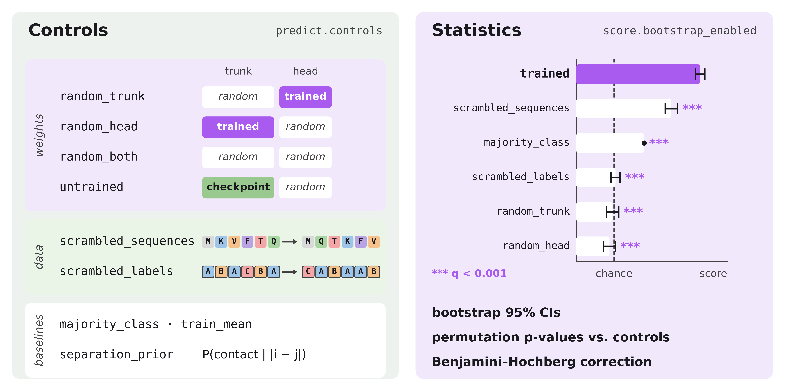

# Controls

A test score on its own doesn't say where the performance comes from: the
pretrained trunk, the tuned head, amino-acid composition, or just the label
distribution. Each control removes one of these. Score then tests whether the
trained model still beats it.

- [How controls flow through a run](#how-controls-flow-through-a-run)
- [Catalog](#catalog)
- [Defaults and compatibility](#defaults-and-compatibility)
- [Interpreting results](#interpreting-results)
- [Statistics](#statistics)
- [Adding a control](#adding-a-control)

## How controls flow through a run

```
steps.predict.controls → Predict: build each control's predictions
                       → Score: paired bootstrap + permutation test vs. trained
                       → scores_long.parquet rows with control=<name>
```

- Predict writes `control_<name>_predictions.parquet` next to
  `predictions.parquet`. `scrambled_labels` needs no inference and has no file.
- Control predictions are rebuilt on every run from the current head. Only
  frozen-trunk embeddings are reused through the embedding cache.
- Comparisons only exist when `steps.score.bootstrap_enabled=true`. The
  base config enables it; the schema default is `false`. Without it,
  controls are predicted but never scored.

## Catalog



*Left: what each control replaces or scrambles. Right: illustrative scores.
`majority_class` is often well above chance on imbalanced tasks; controls that
are not retrained land near chance; how much signal `scrambled_sequences`
keeps depends on the task.*

None of the model controls are retrained, except in layerwise mode
(see the notes below the table). They take the trained model and replace one
part of it.

| Control | What changes | Retrained? | Question it answers |
|---|---|---|---|
| `untrained` | Pretrained checkpoint with a freshly initialized head | No | Did tuning help at all? |
| `random_head` | Trained trunk, re-initialized head | No | Does the tuned head carry the signal? |
| `random_trunk` | Re-initialized trunk, trained head | No (yes in layerwise mode) | Does the head depend on the trunk's learned features? |
| `random_both` | Trunk and head both re-initialized | No | Fully random-weight baseline |
| `scrambled_sequences` | Trained model, residues shuffled within each sequence | — | Does the model use residue order, or only composition and length? |
| `scrambled_labels` | Trained predictions scored against permuted labels | — | Is performance above chance for this label distribution? |
| `majority_class` | Most frequent train class, with the train class prior as probabilities | — | Classification floor; ROC-AUC is 0.5 by construction |
| `train_mean` | Train label mean for every example | — | Regression floor |
| `separation_prior` | Train contact rate for each residue separation | — | Contact floor: "nearby residues touch" |

Details that change the interpretation:

- **`untrained` vs. `random_head`:** with a frozen trunk (`tune_probe`) both
  mean pretrained trunk + random head, so they are redundant. They differ only
  in `finetune`, where `random_head` keeps the fine-tuned trunk.
- **`random_trunk` in layerwise mode:** probes are retrained on a random trunk
  with the same procedure. This is the stronger baseline, separating what
  pretraining adds from what the architecture provides. `random_both` then
  applies untrained heads to that random trunk. See
  [Layerwise linear probes](../README.md#layerwise-linear-probes).
- **`scrambled_sequences`:** special tokens, padding, and each sequence's first
  residue stay in place, so length and composition are preserved.
- **`scrambled_labels` permutes at the task's natural unit:**
  - sequence tasks: across examples;
  - `token_classification`: within each sequence;
  - contact tasks: across scored pairs within each protein. This also destroys
    separation structure, so `separation_prior` is the tighter contact floor.
- **Randomness:** each control re-seeds from the run seed, so its result
  doesn't depend on the order in which controls are built.

Source: [`utils/controls.py`](../src/utils/controls.py); label scrambling is
`scramble_labels` on each task handler in [`src/tasks/`](../src/tasks/).

## Defaults and compatibility

Each task config ships a preset; override it with `steps.predict.controls`
(`[]` disables controls):

| Task type | Controls in the shipped task config |
|---|---|
| `sequence_classification` | `untrained`, `random_trunk`, `random_head`, `random_both`, `scrambled_labels`, `scrambled_sequences`, `majority_class` |
| `sequence_multilabel_classification` | `untrained`, `random_trunk`, `random_head`, `random_both`, `scrambled_labels`, `scrambled_sequences` |
| `sequence_regression` | `untrained`, `random_trunk`, `random_head`, `random_both`, `scrambled_labels`, `scrambled_sequences`, `train_mean` |
| `token_classification` | `untrained`, `random_trunk`, `random_head`, `random_both`, `scrambled_labels` |
| `contact_prediction` | `untrained`, `scrambled_labels`, `separation_prior` |
| `categorical_jacobian` | `scrambled_labels`, `separation_prior` |
| `pseudo_perplexity` | `random_both` |
| `calibration` | `random_both` |

Config validation ([`utils/config_validation.py`](../src/utils/config_validation.py))
rejects these combinations before any work starts:

- `scrambled_sequences` on ragged tasks (`token_classification`, contact
  tasks): position-aligned labels would not move with the shuffled tokens.
- `majority_class` on regression or multilabel tasks; `train_mean` outside
  `sequence_regression`; `separation_prior` outside contact tasks.
- `untrained`, `random_head`, `random_both` with classical heads (`knn`,
  `sklearn_linear`, `random_forest`, `xgboost`): a fitted estimator has no
  random re-initialization.

## Interpreting results

Each control answers a different question, so read them together:

| Trained model beats... | What it shows | If it doesn't |
|---|---|---|
| `scrambled_labels`, `majority_class`, `train_mean`, `separation_prior` | Predictions beat the label or separation prior | The model has learned nothing usable for this task |
| `scrambled_sequences` | The model uses residue order | The task may be solvable from composition and length alone |
| `random_trunk` (layerwise) | Pretrained features beat a random trunk's features under the same probe | The architecture alone, not pretraining, explains the score |
| `untrained`, `random_head`, `random_trunk` (standard), `random_both` | The trained weights are what produce the score | Something is wrong with tuning or loading; check the run |

The last row is mainly a sanity check: a head never trained on random features,
or a random head, usually lands near chance, so beating these is expected.
Use the first three rows to support claims about what a model has learned.

On imbalanced data, `majority_class` is often the hardest floor to beat in
accuracy or weighted F1. MCC and ROC-AUC score it at chance by construction
(0 and 0.5), so check it against a metric where it isn't automatically at chance.

## Statistics

Per (control, metric), Score reports:

- `diff_mean`, `diff_lower`, `diff_upper`: trained − control over paired
  bootstrap resamples (both conditions use the same resampled rows). For
  lower-is-better metrics (`mse`, `mae`, `pseudo_perplexity`, `kl*`), negative favors
  the trained model.
- `p_value`: one-sided paired permutation test of "trained beats control";
  each permutation swaps each example's prediction between the two conditions.
  The smallest possible value is `1 / (n_permutations + 1)`.
- `p_value_adjusted`: Benjamini–Hochberg across controls within each metric.
  Metrics are not pooled, because accuracy, F1, and MCC on the same predictions
  are highly correlated.
- Rows that share a source ID (per-residue rows from one protein, or the
  calibration positions of one protein) are resampled and swapped together.

Column layout and a loading snippet: [Reading results](../README.md#reading-results).
Settings: [Step 4 — Score](../README.md#step-4--score). Implementation:
[`utils/bootstrap.py`](../src/utils/bootstrap.py).

## Adding a control

1. Add the name to the constants and `ControlCondition` in
   [`utils/controls.py`](../src/utils/controls.py), and to the relevant
   `RANDOMIZED_*`/`NO_INFERENCE_CONTROLS` sets.
2. Build its predictions in `ControlBuilder.build` (non-model baselines) or
   `_build_control_model` / `_run_embedding_control_inference` (model
   variants, with and without the embedding cache). Return rows aligned to the
   trained model's `id`s.
3. Reject unsupported task types or heads in
   [`utils/config_validation.py`](../src/utils/config_validation.py).
4. Support or explicitly reject it in layerwise mode
   ([`utils/layerwise.py`](../src/utils/layerwise.py)).
5. Add it to the relevant task presets in `configs/tasks/`.

Score picks up any control present in Predict's output; no scoring changes are
needed. For multi-GPU code paths, follow the
[distributed execution patterns](../README.md#distributed-execution-accelerate-patterns).
