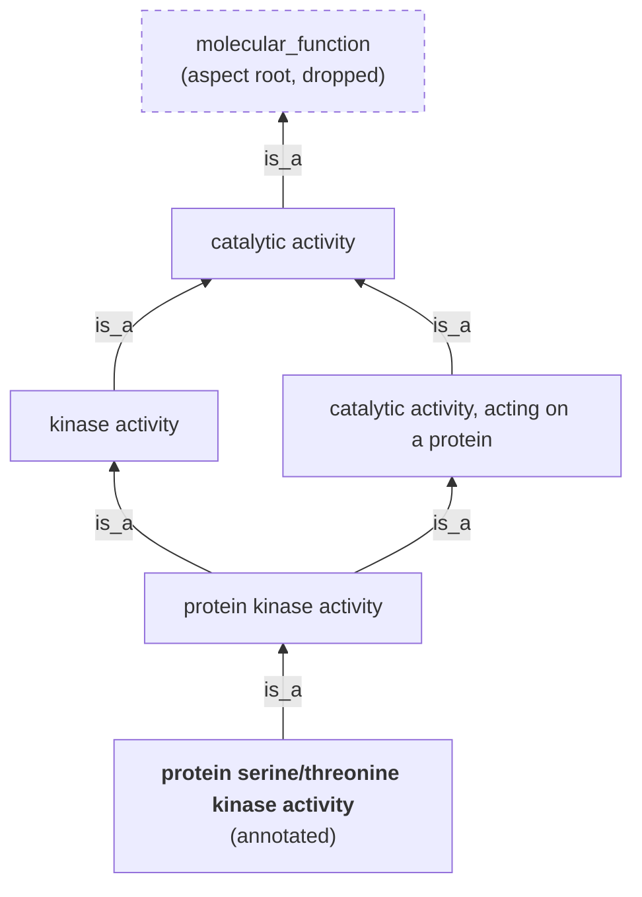

# Dataset Sourcing

Sourcing turns an upstream protein dataset (a Hugging Face repo, a UniProt
query, or a zip of assay CSVs) into the artifact that the
evaluation [Prepare](../README.md#step-1--prepare) step loads: a Hugging Face
dataset with `id`/`sequence`/`targets`/`split` columns and
`train`/`validation`/`test` splits, plus a dataset card and `stats.json`.

Most evaluation overlays load already-published `flair-bio/` artifacts, so
you only need sourcing to rebuild, modify, or publish a dataset. What each
dataset measures is described in the [dataset catalog](datasets.md); the
evaluation workflow is in the [evaluation README](../README.md); ProteinGym
details are in the [ProteinGym guide](proteingym.md).

## Table of Contents

- [Quick Start](#quick-start)
- [How Sourcing Works](#how-sourcing-works)
- [Configuration](#configuration)
- [Shared Behaviour](#shared-behaviour)
  - [Cleaning and deduplication](#cleaning-and-deduplication)
  - [Canonical splits](#canonical-splits)
  - [MMseqs2 clustering settings](#mmseqs2-clustering-settings)
  - [Split subsets](#split-subsets)
  - [Label support filtering](#label-support-filtering)
  - [Caching, outputs, and upload](#caching-outputs-and-upload)
- [Sources](#sources)
  - [Biomap-research](#biomap-research)
  - [UniProtKB background](#uniprotkb-background)
  - [UniProt Gene Ontology](#uniprot-gene-ontology)
  - [UniProt residue annotations](#uniprot-residue-annotations)
  - [InterPro](#interpro)
  - [UniProt ProtParam](#uniprot-protparam)
  - [ProteinGym](#proteingym)
  - [Calibration](#calibration)
- [Adding a New Source](#adding-a-new-source)
- [Gotchas](#gotchas)

---

## Quick Start

**Requirements:** MMseqs2 (clustering) and SeqKit (`stats.json`) on `PATH`.
`bash scripts/setup_binaries.sh` installs both into the project venv. Run every
command from the repo root.

Each script takes its shipped YAML followed by optional `key=value`
overrides (later values win), the same convention as the other modules:

```bash
S=modules/evaluate/scripts/dataset_sourcing
C=modules/evaluate/configs/dataset_sourcing

uv run python             $S/source_biomap_datasets.py     $C/source_biomap_datasets.yaml
uv run python             $S/source_uniprot_go.py          $C/source_uniprot_go.yaml
uv run python             $S/source_uniprot_annotations.py $C/source_uniprot_annotations.yaml
uv run python             $S/source_interpro.py            $C/source_interpro.yaml
uv run --with biopython   $S/source_uniprot_protparams.py  $C/source_uniprot_protparams.yaml
uv run python             $S/source_proteingym.py          $C/source_proteingym.yaml
uv run python             $S/source_calibration.py         $C/source_calibration.yaml
```

`lmdb` and `biopython` are needed only by those two scripts, so `--with`
supplies them without adding them to the project dependencies.

By default, the commands write local artifacts only, under
`eval_datasets/<source>_sourcing/outputs/`. Common overrides:

| Goal | Override |
|---|---|
| Build only some datasets | `all_datasets=false 'datasets=[localization_prediction,ssp_q3]'` |
| Drop long proteins | `max_sequence_length=512` |
| Publish to the Hub (**public** repos) | `repo_owner=<your-hf-username-or-org>` |
| Refresh cached UniProt/InterPro/GO downloads | `force_download=true` |
| All organisms instead of human only | `organism_id=null` |
| Trade annotation confidence for coverage | `review_status=all` (adds automatically annotated TrEMBL) or `review_status=unreviewed` (TrEMBL only) |

---

## How Sourcing Works

There are two flows. Biomap-research uses the generic HF-repository flow,
because its repos already have sequence/label columns and splits, so the only
source-specific settings are a repo template and a column rename. All other
sources need source-specific parsing (GO ontology, UniProt feature
coordinates, 3D contact maps, assay CSVs), so each has its own `run(config)`
that calls shared helpers in its own order.

```
HF-repository flow (Biomap)                Custom flow (UniProt, InterPro, TAPE, ProteinGym)
───────────────────────────                ─────────────────────────────────────────────────
download HF snapshot                       download API/file sources (URL-keyed cache)
→ clean + deduplicate published splits     → parse source-specific labels
→ synthesize validation if missing         → merge identical sequences, filter labels
→ rename to id/sequence/targets/split      → canonical splits: MMseqs2 clusters or upstream
→ optional split subsets                   → optional split subsets
→ parquet + stats.json + README.md         → parquet + stats.json + README.md (+ label_vocabulary.json)
→ optional upload                          → optional upload
```

```
modules/evaluate/
├── configs/dataset_sourcing/source_*.yaml  ← one shipped config per source
├── scripts/dataset_sourcing/source_*.py    ← one entry point per source
└── src/dataset_sourcing/
    ├── config.py      ← shared Pydantic schemas (sourcing, UniProt query, label support, upload)
    ├── spec.py        ← DatasetSourceSpec: repo-id template + column renames (HF flow)
    ├── pipeline.py    ← HF flow (run_cli/run_for_dataset), dataset selection, output dir, run_script
    ├── downloads.py   ← UniProt query/URL building, cached + validated downloads
    ├── preprocess.py  ← cleaning, dedup, validation synthesis, cluster splits, split subsets
    ├── outputs.py     ← parquet shards, stats.json (SeqKit), generic dataset card
    └── hf_io.py       ← HF Hub snapshot download and artifact upload
```

Each run writes under `work_dir`:

```
<work_dir>/
├── downloads/                       ← cached raw inputs, reused across runs
└── outputs/<dataset_name>/
    ├── data/<split>-00000-of-00001.parquet
    ├── stats.json                   ← row counts, columns, SeqKit length metrics
    ├── README.md                    ← generated dataset card (query, filters, seed, split settings)
    └── label_vocabulary.json        ← GO, InterPro, residue annotations: target index → label
```

ProteinGym uses a different layout (per-assay parquet files); see the
[ProteinGym guide](proteingym.md#sourcing).

---

## Configuration

Each script loads its YAML and overrides into a Pydantic config with
`extra="forbid"`, so a misspelled key fails at load time. The **Shipped**
column gives the value in the checked-in YAMLs; where the schema default
differs, that is noted.

| Shipped config | Builds by default |
|---|---|
| [`source_biomap_datasets.yaml`](../configs/dataset_sourcing/source_biomap_datasets.yaml) | All 8 retained Biomap-research datasets |
| [`source_uniprot_go.yaml`](../configs/dataset_sourcing/source_uniprot_go.yaml) | All 3 GO aspects, human Swiss-Prot |
| [`source_uniprot_annotations.yaml`](../configs/dataset_sourcing/source_uniprot_annotations.yaml) | All 12 residue-annotation groups, human Swiss-Prot |
| [`source_interpro.yaml`](../configs/dataset_sourcing/source_interpro.yaml) | All 7 InterPro entry types, human Swiss-Prot |
| [`source_uniprot_protparams.yaml`](../configs/dataset_sourcing/source_uniprot_protparams.yaml) | `uniprot_protparams`, human Swiss-Prot |
| [`source_proteingym.yaml`](../configs/dataset_sourcing/source_proteingym.yaml) | `dms_substitutions` track, assays combined |
| [`run_hhblits.yaml`](../configs/dataset_sourcing/run_hhblits.yaml) | Step 1 of the from-scratch calibration build: HHblits alignments of the human reference proteome (needs HH-suite and a BFD database; one shard per SLURM array task) |
| [`source_calibration.yaml`](../configs/dataset_sourcing/source_calibration.yaml) | Step 2: `human_calibration` from those alignments (≥ 10 homologs, consensus ≥ 0.70), or from precomputed profile CSVs via overrides |

**Selection and paths**

| Field | Shipped | Description |
|---|---|---|
| `all_datasets` | `true` | Process every dataset the source knows; takes precedence over `datasets` |
| `datasets` | full list | Names processed when `all_datasets=false`; unknown names fail with the valid list |
| `work_dir` | `eval_datasets/<source>_sourcing` | Root for `downloads/` and `outputs/`. ProteinGym appends `/<track>` |
| `dataset_name` | `null` | GO only: output-name override, valid with a single aspect |

ProtParam always builds `uniprot_protparams`; the selection fields have no
effect for that standalone source.

**Preprocessing and splits**

| Field | Shipped | Description |
|---|---|---|
| `seed` | `1957723` | Seeds every random choice: validation synthesis, cluster tie-breaks, negative sampling, split subsets. Same seed and inputs give the same splits |
| `max_sequence_length` | `null` | Drops (does not truncate) longer sequences before splitting and clustering. UniProt sources append `_<n>_cutoff` to the dataset name. Not available for ProteinGym |
| `create_split_subsets` | `true` (schema: `false`) | Add pooled `_random`, `_stratified`, and `_cluster` split views (see [Split subsets](#split-subsets)) |
| `split_fractions` | `{train: 0.8, validation: 0.1, test: 0.1}` | UniProt sources: target row shares for cluster-built canonical splits; must sum to 1 |
| `preprocess` | `minimal` | HF-repository flow only: `none` uploads the raw snapshot with a generated card and stats. Other scripts ignore it |
| `source_revision` | unset | HF-repository flow only: upstream HF commit to download. Unset tracks the default branch, which is not reproducible |

Filtering long sequences out rather than truncating them keeps every label
attached to the whole protein it describes. A truncated sequence would lose
residue labels and contacts, and its protein-level label (GO term,
localization) might depend on the region that was cut. The cutoff is applied
before clustering, so split assignment and label support reflect the rows
that actually ship.

**MMseqs2 clustering** (all sources except ProteinGym; rationale in
[MMseqs2 clustering settings](#mmseqs2-clustering-settings))

| Field | Shipped | Description |
|---|---|---|
| `cluster_identity_threshold` | `0.3` | `--min-seq-id` |
| `cluster_coverage_threshold` | `0.8` | `-c`, with `--cov-mode 1` (only the member sequence must be covered) |
| `cluster_num_threads` | `1` | MMseqs2 threads. Raise for large queries such as `organism_id=null` |

**UniProt query and label support** (GO, InterPro, residue annotations, ProtParam)

| Field | Shipped | Description |
|---|---|---|
| `organism_id` | `9606` (human) (schema: `null`) | NCBI Taxonomy ID; `null` selects all organisms |
| `review_status` | `reviewed` (schema: `all`) | `reviewed` = Swiss-Prot, `unreviewed` = TrEMBL, `all` = both |
| `min_label_count` | `5` | GO, InterPro: minimum proteins per label before splitting |
| `min_train_label_count` | `20` | GO, InterPro: minimum positives per label in canonical `train` |
| `min_validation_label_count`, `min_test_label_count` | `3` | GO, InterPro: minimum positives in canonical `validation` and `test` |
| `interpro_download_url` | EBI `current_release` | InterPro: base URL for `entry.list` |

The defaults use human Swiss-Prot. Swiss-Prot entries are manually curated, so
their labels are more reliable than TrEMBL's automatic annotations. Human
is the most thoroughly annotated proteome, and a single proteome keeps
downloads and clustering small. The trade-off is smaller datasets with a
human-only label distribution. `organism_id=null` covers all of Swiss-Prot.

**Upload**

| Field | Shipped | Description |
|---|---|---|
| `upload_layout` | `per_dataset_repo` | `per_dataset_repo`: one repo per dataset; `single_repo`: all datasets in `repo_id` under `<repo_prefix>/<dataset>` |
| `repo_owner` | `null` | `per_dataset_repo` target: `<repo_owner>/<repo_name_prefix><dataset>` |
| `repo_id` | `null` | `single_repo` target |
| `repo_name_prefix`, `repo_prefix` | per source | e.g. `biomap-research-`, `uniprot-`, `proteingym-`, or empty |
| `revision` | `null` | Hub **branch** to commit to; unrelated to `source_revision` |
| `private` | `false` (schema: `true`) | Visibility applied when the repo is created |
| `token` | `null` | Falls back to `HF_TOKEN` / `HUGGINGFACE_HUB_TOKEN` |

If neither `repo_owner` nor `repo_id` is set, the upload is skipped.

**Run controls**

| Field | Shipped | Description |
|---|---|---|
| `force_download` | `false` | Download sources again even when cached |
| `overwrite_output` | `false` (GO, ProteinGym: `true`) | HF-repository flow: never reuse existing outputs. Other sources always rebuild, so this only deletes the output dir first (clearing stale files) |
| `stats_threads` | `8` | SeqKit threads for `stats.json` |

**Source-specific fields:** ProteinGym has `track`, `version`, `base_url`,
`reference_base_url`, `combine_assays`, `train_fraction`, and
`validation_fraction` (see the
[ProteinGym guide](proteingym.md#sourcing)).

---

## Shared Behaviour

### Cleaning and deduplication

**HF-repository flow** (any `DatasetSourceSpec` source; currently Biomap). In order:

1. Trim sequences, then drop rows with a null sequence or target.
2. Drop sequences longer than `max_sequence_length`.
3. Remove exact duplicate sequences, both within each split (keeping the first
   row) and across splits. When a sequence appears in more than one split, it
   is kept in `test`, then `validation`, and removed from `train`.
4. Synthesize `validation` if the source lacks one (see
   [Canonical splits](#canonical-splits)).
5. Rename source columns (`seq` → `sequence`, `label` → `targets`), add
   `split`, derive `id` as `<dataset>_<split>_<row>` when absent, and keep
   only `id`/`sequence`/`targets`/`split`.

Why test-first priority: published test sets stay intact, so scores remain
comparable with upstream results, and no test sequence also appears verbatim
in training. Deduplication runs before validation synthesis, so the
synthesized split's size and its test-homolog exclusion use the final rows.

**UniProt-backed sources.** Entries with identical sequences (for example,
identical paralogs or redundant entries) collapse into one row, which keeps the
first accession as `id`. Their labels are merged: GO and InterPro take the
union of label sets, and residue annotations take a per-residue merge in which
disagreements become ignored. Without this step, one sequence could count
twice toward label support or land on both sides of a split, which is a
trivial leak.

**ProteinGym** applies no deduplication. Its variants are already distinct
within each assay (duplicate variant IDs fail).

### Canonical splits

`train`/`validation`/`test` are the canonical splits, used by evaluation by
default. Sources build them in one of three ways:

| Source | Canonical splits | Why |
|---|---|---|
| Biomap | Upstream splits; `validation` synthesized from `train` only when missing | Results stay comparable with published benchmarks |
| GO, InterPro, residue annotations, ProtParam | Whole MMseqs2 clusters, 80/10/10 | A fresh UniProt query has no splits, so homology-aware ones are built |
| ProteinGym | Seeded random 80/10/10 per assay | Variants share one wild type; see the [ProteinGym guide](proteingym.md#sourcing) |

**Synthesized validation (HF-repository flow).** When a source publishes only
`train` and `test`, a `validation` split is carved out of `train`, with the
same number of rows as `test`:

1. Cluster all train and test sequences together with MMseqs2.
2. Set aside every cluster that contains a test sequence. Its train rows stay
   in `train` and are never moved into `validation`.
3. From the remaining clusters, move whole clusters from `train` to
   `validation`, smallest first, until `validation` reaches the size of
   `test`.

Why it works this way:

- **No shared clusters.** `validation` shares no cluster with `train` or
  `test`, so hyperparameters chosen on `validation` are not tuned toward test
  families.
- **Smallest first.** Adding small clusters lands close to the target size;
  one large cluster could overshoot it.
- **Upstream `train` is not cleaned.** Train rows homologous to `test` stay
  where upstream put them. Removing them would change the published benchmark.

If `mmseqs` is not on `PATH`, `validation` falls back to randomly sampled
train rows (seeded), which may include close homologs of `train`. A warning is
logged. Another warning fires if `validation` would take more than 25% of
`train`.

**Cluster-built splits (UniProt sources).** All rows are clustered once.
Clusters are sorted largest-first (seeded tie-break), and each cluster goes to
the split with the largest relative deficit, `(target − current) / target`.
Placing large clusters while every split still has room, then filling the gaps
with small ones, is a standard greedy bin-packing heuristic that keeps splits
close to 80/10/10. Clusters are indivisible, so a split can overshoot. A
warning is logged when the largest cluster exceeds a split's target.

### MMseqs2 clustering settings

Close homologs usually share structure and function. If they are split
randomly, a test protein typically has a near-identical relative in training,
and the score mostly measures nearest-neighbour lookup rather than
generalization to new families. Keeping each cluster on one side of the split
removes most of that shortcut. Each setting controls how strictly "same
family" is defined:

| Setting | Value | Why |
|---|---|---|
| Identity (`--min-seq-id`) | `0.3` | About 30% identity is the edge of the "twilight zone": below it, pairwise similarity no longer reliably indicates homology. Clustering at this level approximates "no detectable homolog in the other split". Higher values (e.g. `0.5`) give more, smaller clusters and leak more family-level signal |
| Coverage (`-c`) | `0.8` | Requires the alignment to span most of the sequence, so a short shared motif or one domain of a long protein cannot chain unrelated proteins into one giant cluster. A giant cluster would make the 80/10/10 targets unreachable |
| Coverage mode (`--cov-mode`) | `1` (member only) | Only the member sequence must be 80% covered; the representative may be longer. A fragment or single-domain protein therefore joins the cluster of a longer protein that contains it, instead of forming its own cluster that could land in another split. Mode `0` (both sequences covered) would separate them |
| Workflow | `easy-cluster` | The cascaded workflow uses sensitive prefiltering and finds remote homologs near 30% identity. `easy-linclust` is built for speed at high identity, misses many homologs below about 50%, and would under-cluster |
| Threads (`cluster_num_threads`) | `1` | Affects only runtime. The default is conservative for shared machines; raise it for large queries such as `organism_id=null` |
| Seed | `seed` | Clusters are sorted by ID and ties between equal-sized clusters are broken by `seed`, so split assignment does not depend on MMseqs2 output order and reruns are reproducible |

The same settings apply to every cluster-based step: synthesized
validation in the HF-repository flow, cluster-built canonical splits, and the `_cluster` views. This
keeps "held out" meaning the same thing across sources. The values are written
into each dataset card.

Trade-offs:

- **Multi-domain proteins.** Two proteins that share one domain but differ
  elsewhere usually fail the 80% coverage test, so they can land in different
  splits. Lowering `cluster_coverage_threshold` separates them, at the cost of
  larger clusters and splits that miss their size targets more often.
- **Imperfect separation.** Cluster splits reduce homology between splits but
  do not eliminate it. MMseqs2 compares members only with their cluster's
  representative, so members of different clusters can still be more than 30%
  identical to each other.

### Split subsets

With `create_split_subsets: true`, the canonical `train`, `validation`, and
`test` rows (after all filtering) are pooled and repartitioned into
alternative views of the same sizes. The canonical splits are unchanged. The
views contain the same rows, not extra examples: `stats.json` reports
`canonical_rows` separately from `rows_total`.

| Method | Splits | How rows are assigned | What it is for |
|---|---|---|---|
| Random | `*_random` | Seeded uniform shuffle | Homology-leaky reference: the gap between `_random` and `_cluster` scores shows how much performance depends on close homologs |
| Stratified | `*_stratified` | Each stratum greedily balanced across splits | Every split covers the label or target range, which reduces variance from a rare class missing in a small test set |
| Hold-cluster-out | `*_cluster` | Whole MMseqs2 clusters, same algorithm as cluster-built canonical splits | Homology-controlled generalization; for Biomap, a stricter alternative to the upstream splits |

The `_cluster` views need MMseqs2 and at least three clusters (otherwise they
are skipped with a warning). For UniProt sources, the canonical splits are
already cluster-based, so `_cluster` is largely redundant; it differs only
because it is recomputed on the rows left after label filtering.

**How the stratified view groups rows.** Each row is put in a group, and every
group is spread across `train`/`validation`/`test` in proportion to the split
sizes. The group depends on what the target looks like:

| Target | Examples | Group |
|---|---|---|
| A class label (or a number with at most 20 distinct values) | `localization_prediction`, `temperature_stability` | The class |
| A continuous number | `stability_prediction` | Which tenth of the value range it falls in (10 equal-sized bins, by rank), so every split covers low, middle, and high values |
| One label per residue | `ssp_q3`, `uniprot_*` | The protein's most common residue label |
| A set of labels per protein | GO, InterPro | The protein's rarest label, counted over the whole dataset |
| Contact pairs | `contact_prediction_binary` | No sensible group, so no stratified view |

Notes:

- **Sets of labels:** rare labels are the ones most likely to be missing from a
  small test set entirely. Grouping each protein by its rarest label spreads
  those labels first. This is a cheap stand-in for full multi-label
  stratification.
- **Per-residue labels:** this grouping is weak. For sparse features, most
  residues are background, so most proteins end up in the "background" group.
- **Other columns:** ProtParam has no `targets` column, so it groups by
  `length`. ProteinGym groups by assay (`dms_id`), so each assay keeps its
  share in every split; scores are not comparable across assays, so they
  can't be used.
- If every row lands in the same group, the stratified view is skipped.

| Source | `_random` | `_stratified` | `_cluster` |
|---|---|---|---|
| Biomap (scalar or residue targets) | yes | yes | yes |
| Biomap `contact_prediction_binary` | yes | no | yes |
| GO, InterPro, residue annotations, ProtParam | yes | yes | yes |
| ProteinGym | yes | yes (`dms_id`) | no |

**Using a view.** Set `steps.prepare.split.name`, which resolves to
`train_<name>`/`validation_<name>`/`test_<name>`:

```bash
uv run accelerate launch modules/evaluate/src/run_evaluate.py \
    modules/evaluate/configs/config.yaml \
    modules/evaluate/configs/models/amplify_120m.yaml \
    modules/evaluate/configs/tasks/sequence_classification.yaml \
    modules/evaluate/configs/datasets/localization_prediction.yaml \
    steps.prepare.split.name=cluster
```

If the dataset does not publish those splits, Prepare fails and lists the
splits it did find. Datasets with benchmark-specific split names set the roles
explicitly; see [Named benchmark splits](../README.md#named-benchmark-splits).

### Label support filtering

GO and InterPro have many labels, and most are rare. A per-label
score is only meaningful if the probe had enough examples to learn the label
and is tested on enough examples to measure it. A label with 2 training
positives, or 1 test positive, produces a noisy or undefined score that says
little about the embeddings. Labels are therefore kept only when they have
enough positive proteins in every split:

1. **Before splitting:** drop labels carried by fewer than `min_label_count`
   (5) deduplicated proteins. This is a cheap prefilter.
2. **After cluster splitting:** keep a label only if it has at least 20
   positives in canonical `train` (enough to learn from) and at least 3 in
   each of `validation` and `test` (enough to evaluate). Proteins left with no
   label are dropped.

Counts are checked on the actual cluster splits, not estimated from overall
frequency. A label found in only one protein family can end up entirely in one
split, and an estimate would miss that.

Caveats:

- Because test counts help decide which labels are kept, test scores apply to
  that selected label set, not to all GO or InterPro terms.
- The minimums are guaranteed only for the canonical splits. The `_random`,
  `_stratified`, and `_cluster` views can leave a label with few or no
  positives in a holdout.
- Every retained protein has at least one label. The task is "which labels
  apply to this annotated protein", not "is this protein annotated".

### Caching, outputs, and upload

**Download cache.**

- HF-repository snapshots are cached per dataset under
  `downloads/<dataset>/[<source_revision>/]`, so pinned and unpinned snapshots
  never mix.
- URL downloads (UniProt, InterPro, TAPE, ProteinGym) store the request URL in
  a `<file>.url` sidecar and are reused only when it matches.
- UniProt TSVs always request the `organism_id` and `reviewed` columns, and
  every cached or new row is checked against the configured filters before
  use. A file that fails the check is downloaded again rather than trusted.
- The URL does not encode a release, so a cached UniProt TSV or InterPro
  `entry.list` is reused across upstream releases. `go-basic.obo` is reused
  with no identity check at all. Use `force_download=true` to pick up a new
  release; the GO card records the ontology `data-version`.

**Output reuse.** Only the HF-repository flow reuses outputs. A hidden
`.sourcing_config.json` fingerprint stores the output-affecting config, the
spec, and the SHA-256 of each downloaded parquet file. Outputs are reused only
when the fingerprint matches and the data, complete stats, and card all exist.
Settings that do not change the files (token, selection, `work_dir`,
`stats_threads`, upload branch, message, and visibility) are excluded. All
other sources rebuild their outputs from the cached downloads on every run.

**Artifacts.**

- Parquet shards from earlier runs that are no longer produced (for example, a
  dropped split view) are deleted, so they cannot be uploaded.
- `stats.json` records `rows_by_split`, `rows_total` (every view), and
  `canonical_rows` (canonical splits once), plus SeqKit length metrics.
- The card (`README.md`) records the query, filters, evidence rules, seed,
  MMseqs2 settings, and split sizes. Artifacts are published separately from
  this code, so the card is how users reproduce or audit them. Rerun the
  source after changing a filter so the card matches.

**Upload.** Only `data/**`, `README.md`, `label_vocabulary.json`,
`stats.json`, `dataset_infos.json`, and `*.parquet` are uploaded. Remote files
that match those patterns but no longer exist locally are **deleted**, so the
Hub mirrors the local artifact.

---

## Sources

### Biomap-research

Eight retained datasets from the `biomap-research` Hugging Face organization:
`ssp_q3`, `ssp_q8`, `fold_prediction`, `localization_prediction`,
`temperature_stability`, `stability_prediction`, `solubility_prediction`, and
`contact_prediction_binary`. The configured datasets use the HF-repository
flow with `seq` → `sequence` and `label` → `targets`.

Choices:

- **Upstream splits are kept**, with validation synthesized only when missing
  (see [Canonical splits](#canonical-splits)), so scores stay comparable with
  published results. Use `steps.prepare.split.name=cluster` for a
  homology-controlled alternative.
- **Pin `source_revision`** to an upstream commit for a reproducible input.
  The generated card records the revision and links the upstream card for
  label definitions, license, and citation.
- **`preprocess: none`** uploads the downloaded snapshot unchanged, with a
  generated card and stats; it applies no cleaning, length filter, or
  subsets.

```bash
# All 8 retained datasets, local only
uv run python modules/evaluate/scripts/dataset_sourcing/source_biomap_datasets.py \
    modules/evaluate/configs/dataset_sourcing/source_biomap_datasets.yaml

# One retained dataset, pinned, published to <owner>/biomap-research-localization_prediction
uv run python modules/evaluate/scripts/dataset_sourcing/source_biomap_datasets.py \
    modules/evaluate/configs/dataset_sourcing/source_biomap_datasets.yaml \
    all_datasets=false 'datasets=[localization_prediction]' \
    source_revision=<upstream-commit-sha> \
    repo_owner=<your-hf-username-or-org>
```

### UniProtKB background

[UniProtKB](https://www.uniprot.org/) is the central protein knowledge base.
Each entry is one protein: a stable accession (e.g. `P04637`), its sequence,
and annotations compiled from many sources:

- **Literature curation:** UniProt curators read papers and record function,
  sites, and modifications.
- **Other databases:** GO terms (via the GO Annotation project), InterPro
  family and domain memberships, PDB structures, and others are attached as
  annotations or cross-references.
- **Automatic pipelines:** rules and sequence-similarity methods transfer
  annotations to proteins nobody has curated by hand.

UniProtKB has two sections. **Swiss-Prot** (`reviewed`) entries are manually
curated. **TrEMBL** (`unreviewed`) entries are annotated automatically and
are far more numerous. Many annotations also carry an evidence code (an
[ECO](https://www.evidenceontology.org/) ID) saying where they came from, such
as an experiment, a curator's inference, or transfer from a similar sequence.

Because UniProtKB mixes experimental and predicted annotations, the sources
below use its filters to decide what counts as a label: `review_status`
selects curated entries, and the residue-annotation source also filters by
evidence code. The GO, residue-annotation, InterPro, and ProtParam sources all
query UniProtKB's REST API with the configured `organism_id` and
`review_status`.

### UniProt Gene Ontology

The [Gene Ontology](https://geneontology.org/) (GO) is a controlled
vocabulary for describing what gene products do. Each term (e.g.
`GO:0004672`, *protein kinase activity*) has a fixed ID and definition. Terms
are linked from specific to general (`is_a`, `part_of`), forming a hierarchy
rather than a flat list. GO is split into three independent aspects, and
UniProt annotates proteins with terms from each.

A simplified slice of the molecular-function hierarchy (real paths have more
intermediate terms). A term can have several parents, so the hierarchy is a
graph, not a tree. If UniProt annotates a protein only with the bold term, this
source also labels it with every ancestor, and drops the root:



This source builds protein-level multi-label datasets, one per GO aspect:

| Selection | Dataset | Labels |
|---|---|---|
| `molecular_function` | `GO_mf` | Molecular activities such as binding or catalysis |
| `biological_process` | `GO_bp` | Broader processes the protein participates in |
| `cellular_component` | `GO_cc` | Locations or complexes the protein belongs to |

**Pipeline:** one UniProt TSV holds all three aspects. For each aspect:

1. Extract GO IDs and map alternate IDs to primary IDs using `go-basic.obo`.
2. Propagate each annotation to all `is_a`/`part_of` ancestors, then drop the
   aspect root.
3. Merge identical sequences.
4. Filter labels by [support](#label-support-filtering).
5. Build cluster splits.

The result is a multi-hot `targets` vector. `label_vocabulary.json` lists the
GO IDs in vector order (sorted lexicographically) with their term names.

Why these choices:

- **True-path propagation.** GO is a hierarchy: an annotation to *protein
  kinase activity* implies *kinase activity* and *catalytic activity*.
  UniProt lists only the most specific terms, so without propagation a protein
  would be a false negative for every parent term it implicitly carries.
- **`go-basic`** is guaranteed acyclic, and its relations never cross aspects,
  so propagation stays within one aspect.
- **Roots dropped.** The aspect root would be positive for every protein.
- **All evidence codes, including electronic (IEA), are kept.** This
  maximizes coverage. However, many IEA terms are inferred from sequence
  signatures (for example, InterPro2GO), so scores partly measure agreement
  with sequence-based annotation pipelines rather than with experiments. The
  residue-annotation source makes the opposite trade-off.

Names gain `_<n>_cutoff` when `max_sequence_length` is set (for example,
`GO_mf_512_cutoff`). `id` is the UniProtKB accession of the first entry with
each unique sequence. The shipped YAML sets `overwrite_output: true`.

```bash
uv run python modules/evaluate/scripts/dataset_sourcing/source_uniprot_go.py \
    modules/evaluate/configs/dataset_sourcing/source_uniprot_go.yaml \
    all_datasets=false 'datasets=[molecular_function,biological_process]'
```

### UniProt residue annotations

Per-residue classification datasets from UniProtKB sequence features. Each
residue gets one integer target, indexing a sorted `label_vocabulary.json`.

On a real protein, features from several datasets sit on one structure. Human
lysozyme ([P61626](https://www.uniprot.org/uniprotkb/P61626/entry), PDB 1LZ1),
labelled in UniProt numbering:


All labels are real UniProt features, but not all become training labels.
UniProt gives no evidence code for this entry's active sites and disulfide
bonds, so the [evidence filter](#uniprot-residue-annotations) ignores those
residues (`-100`). The helices and strands (PDB evidence) and the signal
peptide (`ECO:0000269`) are kept.

UniProt records features as typed spans or sites on the sequence, each with
its own evidence. Several feature types usually overlap on one protein, and
each dataset reads only the types it needs. A made-up 40-residue membrane
protein:

```
position            1       10        20        30        40
sequence            MKTLLVAGSNETAAAQLLIVFGLAVLAGYRRSPTSEKSDK

Signal peptide      ======
Topological domain        ----------             -----------   Extracellular, Cytoplasmic
Transmembrane                       =============
Glycosylation                ^                                 N-linked asparagine
Modified residue                                   ^ ?         Phosphoserine; Phosphothreonine (rejected: "by similarity")

Targets per dataset
membrane_pass       ----------------TTTTTTTTTTTTT-----------
topology            ------EEEEEEEEEE-------------CCCCCCCCCCC
phosphorylation     -------------------------------P-x------
```

`-` background · `T` transmembrane · `E` extracellular · `C` cytoplasmic ·
`P` phosphoserine · `x` ignored (`-100`). The same protein yields a different
target in each dataset. The phosphothreonine is evidence-rejected, so that
residue is ignored, not counted as background.

| Dataset | UniProt features | Class source |
|---|---|---|
| `uniprot_secondary_structure` | Helix, Beta strand, Turn | Feature type |
| `uniprot_post_translational_modification` | Modified residue, Lipidation, Disulfide bond, Glycosylation | Feature type |
| `uniprot_glycosylation` | Glycosylation | `/note` (e.g. `N-linked asparagine`) |
| `uniprot_phosphorylation` | Modified residue (notes containing `phospho` only) | `/note` (e.g. `Phosphoserine`) |
| `uniprot_lipidation` | Lipidation | `/note` |
| `uniprot_membrane_pass` | Transmembrane, Intramembrane | Feature type |
| `uniprot_topology` | Topological domain | `/note` (e.g. `Cytoplasmic`) |
| `uniprot_peptide` | Propeptide, Signal peptide, Transit peptide | Feature type |
| `uniprot_functional_sites` | Active site, Binding site, DNA binding | Feature type |
| `uniprot_domains` | Domain | Feature type |
| `uniprot_regions` | Region | Feature type |
| `uniprot_structures` | Repeat, Coiled coil, Zinc finger | Feature type |

**Evidence filter.** A feature is labelled only if its own `/evidence`
qualifier contains:

- `ECO:0000269` (experimental evidence, manually asserted) or
- `ECO:0000305` (curator inference, manually asserted);
- for secondary structure only, also `ECO:0007829|PDB:<id>` (taken from a
  solved structure).

Annotations transferred "by similarity" or predicted by sequence models were
inferred from sequence, often from homologs. Training and scoring on them
would reward reproducing those predictors, and the transfer from homologs
would carry information across cluster splits. ECO codes that appear inside
`/note` text are never accepted as evidence.

**Residue labels:**

| Case | Target |
|---|---|
| Accepted feature | Its class index |
| No feature | Background `-` (an index in the vocabulary) |
| Overlapping features with different classes | `-100` (ignored) |
| Feature with rejected evidence or an uncertain (`?`) position | `-100` |
| Residue labelled differently in identical-sequence entries | `-100` |

"Ignored" means the residue has no label at all: `-100` is the ignore index of
the evaluation tasks (as in PyTorch's cross-entropy), so the residue is left
out of the loss and the metrics. It counts as neither a feature nor
background. The protein's other residues are still used.

Disulfide bonds label only their two bonded cysteines, not the span between
them. Note-derived classes drop parentheticals: `N-linked (GlcNAc...)
asparagine` becomes `N-linked asparagine`. A note starting with a qualifier
such as `(Microbial infection)` falls back to the feature type. UniProt's
1-based inclusive coordinates are converted to 0-based residue indices.

**Protein selection:**

- Proteins with at least one accepted annotated residue are kept.
- Feature-free proteins are sampled as negatives, at most one per annotated
  protein (seeded).
- Proteins whose only features were rejected are excluded from that negative
  pool.

Sparse features (lipidation, for example) are absent from most of the
proteome. Without the cap, nearly all rows would be all-background, so a model
could score well by predicting background, and most compute would go to
uninformative proteins. Rejected-evidence proteins are excluded because a
missing experimental record does not mean the feature is absent. Even on
retained proteins, background means "not annotated under these rules", not
verified absence.

```bash
uv run python modules/evaluate/scripts/dataset_sourcing/source_uniprot_annotations.py \
    modules/evaluate/configs/dataset_sourcing/source_uniprot_annotations.yaml \
    all_datasets=false 'datasets=[uniprot_secondary_structure]'
```

### UniProt ProtParam

This source uses UniProt only as a **source of protein sequences**. It runs
the same human Swiss-Prot query and the same MMseqs2 cluster splits as the
other UniProt sources by default, so the protein set is comparable across them. It takes
no annotations from UniProt (apart from `length` and `mass`). The labels are
computed from each sequence with Biopython's
[ProtParam](https://biopython.org/docs/latest/api/Bio.SeqUtils.ProtParam.html)
(`ProteinAnalysis`). These are simple summaries of the residues: composition,
charge, hydrophobicity, and propensity-based estimates.

The output is one dataset, `uniprot_protparams`, with `id`, `sequence`,
`split`, and 31 numeric property columns. It has no `targets` column: select
one property per scalar regression run with `steps.prepare.label_column`.

| Feature | Meaning |
|---|---|
| `length`, `mass` | UniProt-reported length (residues) and molecular mass (Da) |
| `percent_<aa>` | Composition of each of the 20 canonical amino acids (Biopython `amino_acids_percent`) |
| `fraction_helix_aas`, `fraction_turn_aas`, `fraction_sheet_aas` | Composition-based propensity estimates, not observed structure |
| `instability_index` | Guruprasad instability index; above 40 suggests an unstable protein |
| `gravy` | Grand average of hydropathicity; positive values mean more hydrophobic |
| `isoelectric_point` | Theoretical pH with zero net charge |
| `charge_at_ph4_7`, `charge_at_ph7_2`, `charge_at_ph8` | Estimated net charge at pH 4.7, 7.2, and 8.0 |

**Why this dataset:** apart from `length` and `mass`, every property is a
deterministic function of the sequence. The labels are therefore noise-free
probes: they test whether pooled embeddings keep composition, charge, and
hydrophobicity. A low score points to information lost in the representation
or pooling, not to label noise. This makes the dataset a sanity check, not a
biological benchmark. Cluster splits are still used, because homologs have
similar composition and random splits would be easier.

**Processing:**

- Rows are deduplicated by accession and by sequence.
- Trailing `*`/`-` markers are stripped, and rows without a valid UniProt
  length or mass are skipped.
- Ambiguous residues are substituted for the calculation only (`U→C`, `O→L`,
  `B→N`, `Z→Q`, `J→L`, `X→G`); the stored sequence is unchanged.
- The stratified view stratifies on `length`.

```bash
uv run --with biopython modules/evaluate/scripts/dataset_sourcing/source_uniprot_protparams.py \
    modules/evaluate/configs/dataset_sourcing/source_uniprot_protparams.yaml

# Frozen-trunk regression on gravy (the default property).
uv run accelerate launch modules/evaluate/src/run_evaluate.py \
    modules/evaluate/configs/config.yaml \
    modules/evaluate/configs/models/amplify_120m.yaml \
    modules/evaluate/configs/tasks/sequence_regression.yaml \
    modules/evaluate/configs/datasets/uniprot_protparams.yaml \
    modules/evaluate/configs/tuning/torch_linear.yaml \
    workspace.base_path=./eval/protparams/gravy

# Run another of the 31 numeric properties independently. Use a separate
# workspace path for every property so each run's scores/checkpoint is retained.
uv run accelerate launch modules/evaluate/src/run_evaluate.py \
    modules/evaluate/configs/config.yaml \
    modules/evaluate/configs/models/amplify_120m.yaml \
    modules/evaluate/configs/tasks/sequence_regression.yaml \
    modules/evaluate/configs/datasets/uniprot_protparams.yaml \
    modules/evaluate/configs/tuning/torch_linear.yaml \
    steps.prepare.label_column=isoelectric_point \
    workspace.base_path=./eval/protparams/isoelectric_point
```

Repeat for every column listed above. The task overlay supplies R² selection
and reporting defaults. Keep the property-level scores separate; if you
report one summary across properties, average those R² values equally.

The dataset overlay points to the local artifact. Override
`workspace.dataset_repo_id` if you uploaded it.

### InterPro

[InterPro](https://www.ebi.ac.uk/interpro/) (EMBL-EBI) classifies proteins
into families and identifies their domains and functional sites. It combines
predictive signatures (HMMs, profiles, patterns) from about a dozen member
databases, such as Pfam, PROSITE, SMART, PANTHER, and CATH-Gene3D, into
single entries. Each entry has a type: family, domain, homologous
superfamily, repeat, or a kind of site.

It complements the other UniProt sources:

- **What a protein *is*, not what it *does*.** GO terms describe function,
  process, and location. InterPro entries describe evolutionary and structural
  units: which family a protein belongs to and which domains it is built
  from.
- **Coverage.** Entries are assigned by running signature models over every
  sequence, so nearly every protein has some, including poorly studied ones
  with little GO or feature annotation.
- **Protein-level view of domains and sites.** Residue annotations say *where*
  a curated feature is. InterPro says *whether* a protein carries a domain or
  site type, across many more proteins.

This source builds protein-level multi-label datasets, one per InterPro entry
type: `interpro_active_site`, `interpro_binding_site`,
`interpro_conserved_site`, `interpro_domain`, `interpro_family`,
`interpro_homologous_superfamily`, and `interpro_repeat`. A positive bit means
that the protein matches that entry; it does not say where in the sequence the
match is.

**Sources:**

- Entry types and names come from the EBI release `entry.list`.
- Protein-to-entry memberships come from UniProt's `xref_interpro` field for
  the configured query. This avoids downloading InterPro's multi-gigabyte
  `protein2ipr.dat.gz` just to subset one proteome.

Identical sequences are merged, labels go through the same
[support filtering](#label-support-filtering) as GO, and splits are
cluster-built. `label_vocabulary.json` records each entry's accession, name,
and type, in accession order.

**What this measures:** InterPro memberships come from running signature
models (HMMs, profiles, patterns) over the sequence, so the labels are
sequence-derived by construction. The task asks whether embeddings capture
what those models detect. With 30%-identity cluster splits, that means
recognizing family, domain, or superfamily membership for remote homologs,
which is hardest for `homologous_superfamily`, whose entries are defined by
structure-based remote homology.

```bash
uv run python modules/evaluate/scripts/dataset_sourcing/source_interpro.py \
    modules/evaluate/configs/dataset_sourcing/source_interpro.yaml \
    all_datasets=false 'datasets=[interpro_domain]'
```

### ProteinGym

ProteinGym has its own data contract and runners; the
[ProteinGym guide](proteingym.md#sourcing) covers it in full. Its sourcing
choices differ from the other sources:

- Splits are seeded random 80/10/10 **within each assay**, because DMS scores
  and clinical labels are assay-specific. Each assay gets an independent seed
  derived from `seed` and its `dms_id`.
- There is no MMseqs2 clustering: every variant in an assay is a mutant of the
  same wild type, so sequence-identity clusters carry no information. For
  position-aware generalization, use ProteinGym's official
  `fold_contiguous_5`/`fold_modulo_5` columns, which are preserved.
- Assays with fewer than 3 variants get no split labels.

```bash
uv run python modules/evaluate/scripts/dataset_sourcing/source_proteingym.py \
    modules/evaluate/configs/dataset_sourcing/source_proteingym.yaml \
    track=dms_substitutions
```

### Calibration

`human_calibration` stores, for each conserved column of a human protein,
the amino-acid frequencies among its homologs (see the
[dataset entry](datasets.md#calibration)). It can be built from either input:

- **From scratch (alignments).** Two steps:
  1. [`run_hhblits.py`](../scripts/dataset_sourcing/run_hhblits.py) downloads the
     UniProt human reference proteome (UP000005640) and runs HHblits once per
     protein. It writes `<work_dir>/a3m/<accession>.a3m`, with HHblits
     defaults `-id 99 -cov 50 -qid 50`.
     - Requires [HH-suite](https://github.com/soedinglab/hh-suite)
       (`conda install -c bioconda hhsuite`) and a database such as full
       [BFD](https://bfd.mmseqs.com/), which is ~272 GB to download and
       ~1.8 TB unpacked.
     - Each protein takes minutes, so run it as a SLURM array. Inside an
       array job, `shard_index`/`shard_count` default to the array task.
     - Existing alignments are skipped, so a rerun resumes.
  2. `source_calibration.py` with `a3m_dir` builds the profiles:
     - It strips insertions (lowercase), counts the query plus its homologs at
       each query column, ignoring gaps and non-standard letters.
     - It keeps columns whose top residue reaches `min_consensus_freq`.
     - It skips proteins with fewer than `min_homologs` homologs.
- **From precomputed CSVs.** `source_calibration.py` with `proteome_path` and
  `consensus_path` rebuilds the published dataset from precomputed profiles.
  These lack homolog counts, so `min_homologs` does not apply.

Any a3m directory works for step 2, so a new organism or database only needs a
different `fasta`/`database` in step 1.

```bash
S=modules/evaluate/scripts/dataset_sourcing
C=modules/evaluate/configs/dataset_sourcing

# Step 1, on a cluster: 100 array tasks, each aligning 1/100 of the proteome
sbatch --array=0-99 --cpus-per-task=8 --wrap \
    "uv run python $S/run_hhblits.py $C/run_hhblits.yaml database=/path/to/bfd/bfd_metaclust_clu_complete_id30_c90_final_seq.sorted_opt cpu=8"

# Step 2, once all shards are done
uv run python $S/source_calibration.py $C/source_calibration.yaml

# Or build from precomputed profile CSVs
uv run python $S/source_calibration.py $C/source_calibration.yaml a3m_dir=null \
    proteome_path=/path/to/proteome.csv consensus_path=/path/to/consensus.csv
```

---

## Adding a New Source

**If the source is an HF dataset repo** whose `data/` folder has
`train-*.parquet` and `test-*.parquet` shards (validation optional, named
`valid`, `validation`, or `val`), and only needs column renames, use the
HF-repository flow. You get cleaning, deduplication, validation synthesis,
subsets, fingerprinted reuse, a card, and upload for free:

```python
class SourceMyConfig(DatasetSourcingConfig):
    work_dir: Path = Path("eval_datasets/my_sourcing")
    repo_name_prefix: str = "my-"

MY_SPEC = DatasetSourceSpec(
    known_datasets=["task_a", "task_b"],
    repo_id_template="upstream-org/{dataset_name}",
    column_rename={"seq": "sequence", "label": "targets"},
    card_descriptions={"task_a": "One-line intended use."},
)

def main() -> None:
    run_cli(sys.argv[1:], model_cls=SourceMyConfig, spec=MY_SPEC)
```

**Otherwise**, write a `run(config)` and call `run_script(MyConfig, run)`.
[`source_interpro.py`](../scripts/dataset_sourcing/source_interpro.py) is a
compact template. Reuse:

| Need | Helper |
|---|---|
| Config base | `DatasetSourcingConfig`; `UniProtDatasetSourcingConfig` (query and split fractions); `UniProtLabelSupportConfig` (adds support floors) |
| Dataset selection | `resolve_datasets` |
| Cached downloads | `download_url` (`cache_identity`, `validator`), `download_uniprot_tsv`, `read_uniprot_tsv` |
| Merge duplicate sequences | `merge_label_sets_by_sequence` |
| Cluster splits, support filter, subsets | `split_by_clusters`, or `create_full_dataset_splits` + `create_split_subsets(stratification_column=...)` |
| Outputs | `prepare_output_dir`, `write_hf_split_files`, `write_dataset_stats`, `mmseqs_settings_lines` (for your card) |
| Upload | `upload_dataset_artifact` |

Decisions to make, and record in the card:

- **Splits:** keep upstream splits only when comparability with published
  numbers matters; otherwise build cluster splits.
- **Duplicates:** merge identical sequences before counting labels or
  splitting.
- **Negatives:** state what an absent label means (verified absence, or just
  "not annotated").
- **Evidence:** decide which annotations are trusted. Labels predicted from
  sequence make the task partly circular.
- **Stratification:** set `stratification_column` if `targets` is missing or
  not meaningful.

Add a YAML under `configs/dataset_sourcing/` and tests under
`tests/evaluate/`.

---

## Gotchas

| Symptom | Cause and fix |
|---|---|
| Hub repo became public | The shipped YAMLs set `private: false`. Set `private=true` before the first upload; it applies only when the repo is created |
| Files disappeared from a Hub repo | Uploads delete remote artifacts that are absent locally. Upload from a complete output dir |
| Rebuilt dataset matches an old UniProt/InterPro/GO release | Downloads are cached by URL, not by release. Add `force_download=true` |
| Synthesized validation warns about random sampling | `mmseqs` not on `PATH`, so validation may contain train homologs. Run `bash scripts/setup_binaries.sh` |
| `_cluster` splits missing | Fewer than three MMseqs2 clusters, or MMseqs2 unavailable; check the log warning |
| `_stratified` splits missing | Contact-pair targets, or all rows in one stratum (by design) |
| A GO/InterPro label has no positives in `test_random` | Support floors apply only to the canonical splits |
| `include_train_unfiltered=true` has no effect | It is dropped when `create_split_subsets` is true |
| `ModuleNotFoundError: lmdb` / `Bio` | Run with `uv run --with lmdb` / `uv run --with biopython` |
| Rerun replaced GO or ProteinGym outputs | Their YAMLs set `overwrite_output: true` |
