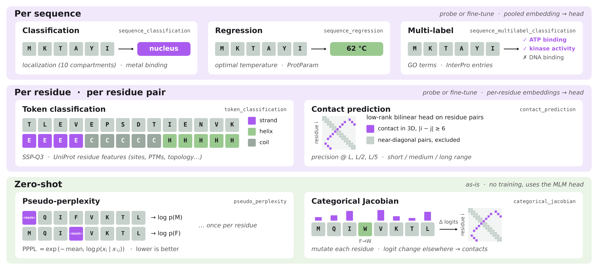
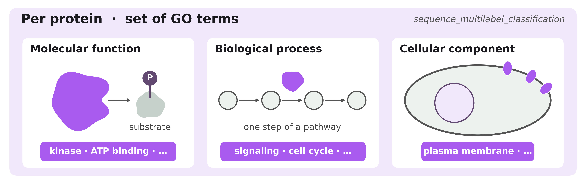
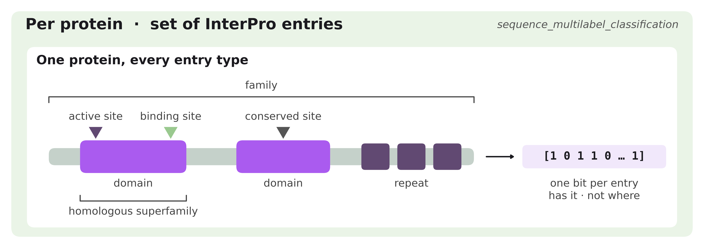
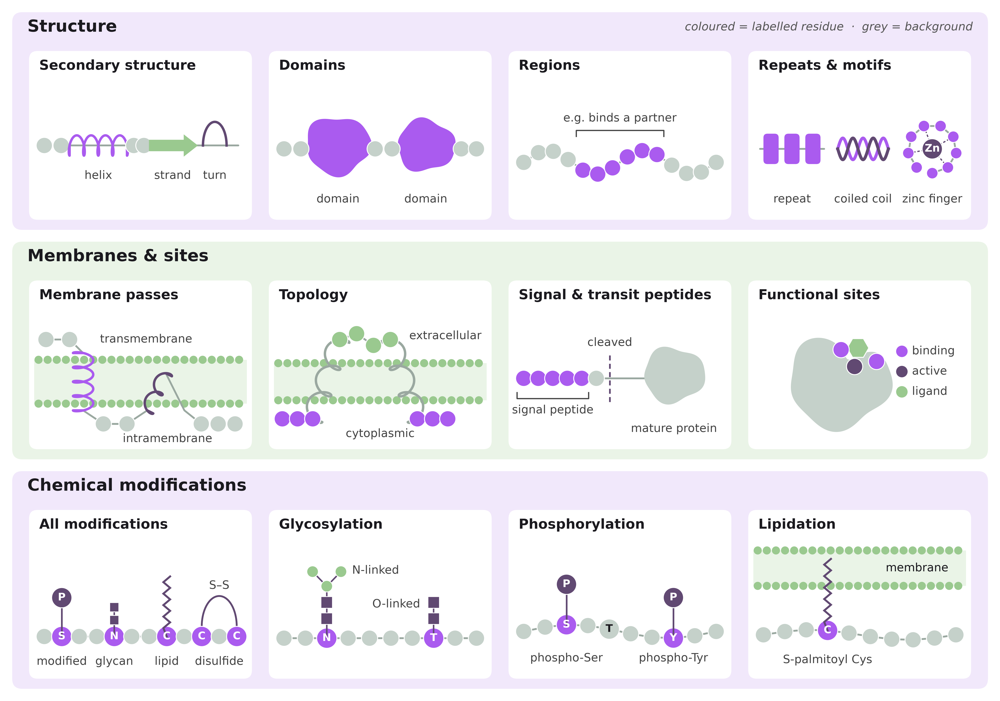

# Evaluation Dataset Catalog

This catalog lists every evaluation dataset: what question it asks about a
protein, what one target looks like, where the question comes up in the real
world, and which task consumes it. Each active dataset has an overlay YAML in
[`configs/datasets/`](../configs/datasets/) that plugs it into the
`run_evaluate.py` pipeline; how overlays are combined with the base, model,
and task configs is covered in the evaluation README's
[Config files](../README.md#config-files) section. How the underlying
artifacts are built (sources, filters, splits, rationale) is covered in the
[dataset-sourcing guide](dataset-sourcing.md).

**New here?** Read [Evaluation Tasks](#evaluation-tasks) for the eight kinds
of prediction, then skim the cartoon at the top of each source in
[Datasets in Detail](#datasets-in-detail) and read the entries that
interest you.

## Table of Contents

- [Evaluation Tasks](#evaluation-tasks)
- [Datasets by Task](#datasets-by-task)
- [Datasets in Detail](#datasets-in-detail)
  - [Biomap-Research](#biomap-research)
  - [UniProt Gene Ontology](#uniprot-gene-ontology)
  - [InterPro](#interpro)
  - [UniProt Residue Annotations](#uniprot-residue-annotations)
  - [UniProt ProtParam](#uniprot-protparam)
  - [Calibration](#calibration)
- [Separate Dataset Workflows](#separate-dataset-workflows)

---

## Evaluation Tasks

Each dataset is evaluated with one of eight tasks; the names are the
`workspace.task_type` values. A task fixes what the model predicts (one value
per protein, per residue, or per residue pair) and therefore the shape of the
dataset's `targets`.

| Task | Predicts | Example `targets` for one protein | Meaning |
|---|---|---|---|
| `sequence_classification` | One class per protein | `3` | Class index in the dataset's label vocabulary |
| `sequence_regression` | One number per protein | `62.0` | e.g. optimal temperature in °C |
| `sequence_multilabel_classification` | A set of labels per protein | `[0, 1, 1, 0, …]` | One bit per vocabulary entry (GO term, InterPro entry); several can be on |
| `token_classification` | One class per residue | `[0, 0, 2, 2, 2, 1, -100, …]` | One class index per residue (same length as the sequence); `-100` is ignored |
| `contact_prediction` | Which residue pairs touch | `[[3, 17], [5, 40], …]` | Positive pairs only; other valid pairs at separation ≥ 6 are negatives |
| `categorical_jacobian` | Contacts, zero-shot | same as `contact_prediction` | No training: contacts are read from how masked-LM logits react to mutations |
| `pseudo_perplexity` | Nothing (zero-shot) | none | Each residue is masked in turn and the model scores the original amino acid |
| `calibration` | Homolog profile (zero-shot) | `[[12, f_A, …, f_Y], …]` | One `[position, 20 homolog frequencies]` entry per conserved column; `label_format: consensus_profile` |

**Why each task matters.** Each task tests a different kind of knowledge a
protein language model should pick up from sequence alone:

- **Sequence classification and regression** test whether one summary of the
  protein captures whole-protein properties such as location, solubility, or
  stability. These are the questions asked when annotating new proteins or
  screening designed ones.
- **Multi-label classification** tests whether the model captures function and
  family membership. Most proteins have several functions or domains, so this
  mirrors genome annotation, where function must be inferred for proteins
  that have never been studied in the lab.
- **Token classification** tests whether the model knows *where* things happen
  along the chain: helices, binding sites, membrane spans, modified residues.
  Engineering and variant interpretation rely on this, because a mutation's
  effect depends on the site it hits.
- **Contact prediction** tests whether the model encodes 3D structure.
  Residues far apart in sequence but touching in the fold reveal the fold
  itself, so good contacts suggest the model has learned structure without
  seeing any.
- **Categorical Jacobian** asks the same question with no training at all.
  It checks whether the masked language model has learned, on its own, that
  residues in contact change together. This mirrors the co-evolution signal
  that structure predictors use.
- **Pseudo-perplexity** measures how well the model predicts each real
  residue when it is hidden; lower means the model finds natural proteins
  less surprising. It needs no labels, so it is a quick check of
  pretraining. Scores depend on the tokenizer, so compare them only between
  checkpoints of the same model.
- **Calibration** masks each conserved residue of a human protein and compares
  the model's distribution over the 20 amino acids to the frequencies seen in
  its homologs (KL divergence). Positions split into T (human residue equals
  the consensus) and NT (it differs); on NT, `accuracy_nt` counts consensus
  predictions and `memorization_nt` counts predictions of the human residue,
  which signals memorization rather than learned evolutionary constraint.

`categorical_jacobian` is a zero-shot contact-ranking method scored against
contact-pair labels, not a trainable contact head. `pseudo_perplexity` works
on any sequence dataset, as long as the model is a masked language model whose
tokenizer has a mask token.

---

## Datasets by Task

Each dataset is built for one task, except the contact datasets, which serve
both contact tasks. Default metrics are each task's `default_metric_names`;
the task handlers in [`src/tasks/`](../src/tasks/) define a few more that can
be selected.

| Source | Datasets | Task | Default metrics |
|---|---|---|---|
| Biomap-research | `fold_prediction`, `localization_prediction` | `sequence_classification` | `f1`, `accuracy`, `mcc`, `roc_auc` |
| UESolDS | `solubility_prediction` | `sequence_classification` | Macro-F1 |
| HMD-ARG | `antibiotic_resistance` | `sequence_classification` | Macro-F1 over 14 drug classes |
| FLIP / Meltome Atlas | `meltome_mixed`, `meltome_human` | `sequence_regression` | `spearmanr` |
| Biomap-research | `stability_prediction` | `sequence_regression` | `mse`, `mae`, `r2`, `pearsonr`, `spearmanr` |
| Reprocessed BioMap SSP | `ssp_q3`, `ssp_q8` | `token_classification` | Macro-F1 |
| CASP14-16 | `contact_prediction_casp` | `contact_prediction` | AUC, P@L, P@L/2, P@L/5 and ROC-AUC; global and intra-EU, original separations >=6/24 |
| UniProt GO | `GO_mf`, `GO_bp`, `GO_cc` | `sequence_multilabel_classification` | `f1`, `multilabel_mcc`, `average_precision` |
| InterPro | 7 `interpro_*` entry types | `sequence_multilabel_classification` | `f1`, `multilabel_mcc`, `average_precision` |
| UniProt features | 12 `uniprot_*` residue overlays | `token_classification` | `f1`, `accuracy`, `precision`, `recall`, `mcc` |
| UniProt ProtParam | `uniprot_protparams` (one property per run) | `sequence_regression` | R² |
| AMPLIFY / UR100P | `uniprot_ur100p_test` | `pseudo_perplexity` | `pseudo_perplexity` |
| Any sequence dataset | MLM models with a mask token | `pseudo_perplexity` | `pseudo_perplexity` |
| HHblits/BFD homolog profiles | `human_calibration` (test split only) | `calibration` | `kl`, `kl_t`, `kl_nt`, `calibration`, `calibration_t`, `calibration_nt`, `accuracy_t`, `accuracy_nt`, `memorization_nt` |
| ProteinGym | 4 assay tracks | Separate runners | Spearman (DMS), AUC (clinical), per assay |

ProteinGym uses separate runners. The next section describes the active
evaluation overlays.

---

## Datasets in Detail

One subsection per source, each opening with a cartoon of its datasets. Every
dataset is then described the same way:

- **Question:** what the dataset asks about a protein, in plain words.
- **Readout:** what one target is, and how many classes or labels it has.
- **Used for:** where the same question comes up in research or industry.
- **Why it matters:** what a good score says about the model.
- **Run:** the overlay YAML, the task YAML to pair it with, and the
  published `flair-bio/` Hub artifact.

**Target sizes** reflect the published artifacts when each entry was added.
Multi-label widths come from `label_vocabulary.json`; scalar and per-residue
class counts are taken across the canonical train, validation, and test
splits. Recheck them when hosted artifacts change.

### Protein-level benchmarks

These classification and regression benchmarks use their published splits.
Each entry identifies its source and links to the dataset card for full label
definitions.

#### Per protein: one class

##### `fold_prediction`

**Question:** which of 1,195 known structural folds does this protein adopt?

- **Readout:** one fold class out of 1,195, from the SCOP 1.75 structural
  classification (2009).
- **Used for:** finding remote relatives of a new protein, such as an emerging
  antibiotic-resistance gene or an industrial enzyme. Proteins with the same
  fold often share too little sequence for alignment tools to connect them,
  yet the fold already hints at function.
- **Why it matters:** the fold is a property of 3D structure, so a good score
  means the embedding groups proteins by shape, not by sequence identity.
  With 1,195 classes and few examples each, it is one of the hardest
  classification tasks here.
- **Run:** [`fold_prediction.yaml`](../configs/datasets/fold_prediction.yaml)
  with `sequence_classification` ·
  [Hub](https://huggingface.co/datasets/flair-bio/biomap-research-fold_prediction)

##### `localization_prediction`

**Question:** where in the cell does this protein end up?

- **Readout:** one of 10 compartments (for example nucleus, cytoplasm,
  mitochondrion, cell membrane, or outside the cell), from the DeepLoc
  dataset of UniProt proteins.
- **Used for:** annotating new proteomes, picking drug targets an antibody
  can reach (only cell-surface and secreted proteins are accessible), and
  explaining disease mutations that send a protein to the wrong place.
- **Why it matters:** where a protein is decides what it can do. It meets
  its partners, substrates, and pH only in its own compartment, so the same
  protein can be active in one place and inert in another. For example, the
  transcription factor NF-κB waits in the cytoplasm and only switches genes
  on after a signal moves it into the nucleus. Proteins are routed by sorting
  signals written in the sequence (signal peptides, nuclear localization
  signals, transit peptides) and by overall composition. A good score means
  the embedding keeps these signals.
- **Run:** [`localization_prediction.yaml`](../configs/datasets/localization_prediction.yaml)
  with `sequence_classification` ·
  [Hub](https://huggingface.co/datasets/flair-bio/biomap-research-localization_prediction)
- **External test:** the overlay also configures setHARD
  ([dataset card](https://huggingface.co/datasets/flair-bio/sethard)) as a
  test-only set scored by the DeepLoc-fitted probe. Verify that its class-index
  mapping matches BioMap's before interpreting the score: BioMap's card
  documents integer labels but does not name the classes.

##### `solubility_prediction`

**Question:** will this protein stay dissolved when produced in bacteria, or
clump into insoluble aggregates?

- **Readout:** soluble or insoluble protein expression, from UESolDS as
  distributed with PLM_Sol V1.1. Targets use `0 = insoluble`, `1 = soluble`;
  report Macro-F1 over both classes. The standardized splits contain 69,964
  training, 3,995 validation, and 3,998 test proteins.
- **Used for:** choosing which constructs to express before spending lab
  time, and screening designed proteins and biologics for manufacturability.
- **Why it matters:** soluble expression matters for producing proteins in
  laboratory systems. The labels reflect experimental expression conditions,
  not context-independent intrinsic solubility.
- **Run:** [`solubility_prediction.yaml`](../configs/datasets/solubility_prediction.yaml)
  with `sequence_classification` ·
  [Hub](https://huggingface.co/datasets/flair-bio/solubility_uesolds_original)

##### `antibiotic_resistance`

**Question:** which antibiotic drug class is associated with this protein?

- **Readout:** one of 14 mutually exclusive drug classes from HMD-ARG. This
  artifact is single-label classification, not resistant-versus-susceptible
  detection or multilabel prediction; `multidrug` is one class.
- **Provenance:** standardized from ProtAlign-ARG GraphPart partitions and the
  ARGs repository, as documented in the dataset card. The card pins the
  upstream revisions.
- **Splits:** 12,844 train, 984 validation, and 2,603 test proteins.
  `tuning_excluded` contains 490 additional proteins and is used only in the
  final refit, after hyperparameter selection on train and validation.
- **Metric:** Macro-F1 over the fixed 14-class vocabulary. Validation has no
  sulfonamide examples; absent classes contribute zero F1.
- **Limitation:** class balance is highly skewed; test contains only two
  rifampin and three bacitracin proteins.
- **Labels:** aminoglycoside, bacitracin, beta-lactam, chloramphenicol,
  fosfomycin, glycopeptide, macrolide-lincosamide-streptogramin, multidrug,
  polymyxin, quinolone, rifampin, sulfonamide, tetracycline, and trimethoprim.
- **Run:** [`antibiotic_resistance.yaml`](../configs/datasets/antibiotic_resistance.yaml)
  with `sequence_classification` ·
  [Hub](https://huggingface.co/datasets/flair-bio/amr_hmd_arg)

#### Per protein: one number

##### `meltome_mixed` and `meltome_human`

**Question:** how well does a protein tolerate heating in an experimental assay?

- **Readout:** experimentally measured apparent melting temperature in °C,
  evaluated as regression with Spearman's ρ. `meltome_mixed` covers mixed
  species; `meltome_human` is restricted to human proteins.
- **Used for:** ranking candidate proteins by measured thermostability,
  including proteins considered for industrial use.
- **Limitations:** apparent melting temperature depends on assay context and
  is not a context-independent measure of intrinsic stability. Treat mixed
  and human as separate benchmarks; do not combine their scores as if they
  were independent.
- **Run:** [`meltome_mixed.yaml`](../configs/datasets/meltome_mixed.yaml) or
  [`meltome_human.yaml`](../configs/datasets/meltome_human.yaml) with
  `sequence_regression` · [Mixed dataset](https://huggingface.co/datasets/flair-bio/meltome_mixed)
  · [Human dataset](https://huggingface.co/datasets/flair-bio/meltome_human)

##### `stability_prediction`

**Question:** how well does this small designed protein resist being cut up
by proteases?

- **Readout:** one stability score per sequence; higher means more resistant
  than an unfolded chain would be. Data from Rocklin et al.: de novo designed
  mini-proteins (about 40 residues) and their mutants, as packaged by TAPE.
- **Used for:** de novo protein design: ranking designs by likely stability
  before ordering genes and running experiments.
- **Why it matters:** designed sequences are unlike natural ones, so this
  tests whether the model generalizes beyond the proteins it was trained on.
  Proteases cut mostly unfolded chains, so the score tracks folding
  stability.
- **Run:** [`stability_prediction.yaml`](../configs/datasets/stability_prediction.yaml)
  with `sequence_regression` ·
  [Hub](https://huggingface.co/datasets/flair-bio/biomap-research-stability_prediction)

#### Per residue and per residue pair

##### `ssp_q3`

**Question:** is each residue in a helix, a strand, or a coil?

- **Readout:** one of 3 classes per residue: `0=H` (helix), `1=E` (strand),
  `2=C` (coil), consistently derived from the DSSP Q8 labels.
- **Used for:** a first look at the structure of a protein with no solved
  structure; guiding domain boundaries and design.
- **Why it matters:** the classic per-residue benchmark. Most protein
  language models do well, so a low score points to a problem with
  per-residue embeddings.
- **Run:** [`ssp_q3.yaml`](../configs/datasets/ssp_q3.yaml) with
  `token_classification` ·
  [Hub](https://huggingface.co/datasets/flair-bio/biomap-research-ssp_q3_masked)

##### `ssp_q8`

**Question:** the same as `ssp_q3`, with finer states.

- **Readout:** one of 8 DSSP classes per residue: `0=G`, `1=H`, `2=I`,
  `3=B`, `4=E`, `5=S`, `6=T`, `7=C`.
- **Used for:** as `ssp_q3`.
- **Why it matters:** harder than Q3. Some states (π-helix, β-bridge) are
  rare, so macro-averaged metrics expose whether the model handles them.
- **Run:** [`ssp_q8.yaml`](../configs/datasets/ssp_q8.yaml) with
  `token_classification` ·
  [Hub](https://huggingface.co/datasets/flair-bio/biomap-research-ssp_q8_masked)

Both datasets contain 9,218 train, 1,627 validation, and 663 test
observations. Targets use `-100` for residues outside the ordered-residue and
source scoring-region masks; these positions are excluded from loss and
Macro-F1. There are 2,187,951, 395,726, and 119,273 scored residues in the
three splits, respectively. Repeated sequences remain separate observations
because their scoring regions or labels can differ. The longest sequence is
1,632 residues; the overlays allow up to 2,048 tokens, including special
tokens, so the supplied residues are not cropped.

##### `contact_prediction_casp`

**Question:** which pairs of residues touch in the folded protein?

- **Readout:** self-contained global and intra-EU rows with original chain
  indices, valid structural positions and positive contact pairs. Other
  pairs between valid residues are negative; unresolved residues are unknown.
  Runtime ambiguity cleaning preserves original positional gaps and pair
  separations. There is no cropping or coordinate-file dependency.
- **Used for:** contacts were the key input to early structure predictors
  (including the first AlphaFold), and they still help to check folds and to
  find residues that interact.
- **Why it matters:** contacts between residues far apart in sequence define
  the fold. Good long-range precision is the clearest sign that a model has
  learned 3D structure from sequence alone.
- **Splits:** 20 training and 20 validation structures; CASP14-16 testing.
  Metrics retain global/EU identities and aggregate EU -> chain -> complex ->
  edition, without pooling different settings or editions.
- **Run:** [`contact_prediction_casp.yaml`](../configs/datasets/contact_prediction_casp.yaml)
  with task `contact_prediction`, either the explicit
  [`contact_embedding`](../configs/predictors/contact_embedding.yaml) or
  [`contact_attention`](../configs/predictors/contact_attention.yaml) predictor,
  an immutable HF dataset revision and one configured seed. Categorical-Jacobian
  integration is pending.
  [Hub](https://huggingface.co/datasets/flair-bio/contact_prediction_casp)

### UniProt Gene Ontology

Protein-level multi-label prediction of UniProtKB Gene Ontology terms, one
overlay per GO aspect ([sourcing](dataset-sourcing.md#uniprot-gene-ontology)).
The [Gene Ontology](https://geneontology.org/) is the standard vocabulary for
describing what a protein does, in three independent aspects.

**Question:** which GO terms describe this protein?

- **Readout:** a multi-hot vector with one bit per retained term
  (`label_vocabulary.json`); a protein usually has several. Annotations are
  propagated to parent terms, so a protein labelled *protein kinase activity*
  also counts as having *kinase activity*.
- **Used for:** annotating new genomes. Most sequenced proteins have never
  been studied in the lab, so their function is inferred from sequence; GO
  terms are the format those predictions take (as in the CAFA challenges).
  The terms also feed pathway-enrichment analyses of screens and disease
  studies.
- **Why it matters:** a good score means the embedding encodes function, not
  just family. Splits keep proteins with more than 30% identity apart, so
  function must be recognized in unfamiliar proteins.

| Overlay | Question | Example terms | Labels | Hub |
|---|---|---|---|---|
| [`GO_mf`](../configs/datasets/GO_mf.yaml) | What does the protein do at the molecular level? | ATP binding, protein kinase activity, DNA binding | 441 | [uniprot-GO_mf](https://huggingface.co/datasets/flair-bio/uniprot-GO_mf) |
| [`GO_bp`](../configs/datasets/GO_bp.yaml) | Which biological processes does it take part in? | signal transduction, DNA repair, immune response | 2,333 | [uniprot-GO_bp](https://huggingface.co/datasets/flair-bio/uniprot-GO_bp) |
| [`GO_cc`](../configs/datasets/GO_cc.yaml) | Where does it act: which compartment or complex? | nucleus, plasma membrane, ribosome | 440 | [uniprot-GO_cc](https://huggingface.co/datasets/flair-bio/uniprot-GO_cc) |

Run every GO overlay with `sequence_multilabel_classification`.
`GO_bp` is usually the hardest: a process depends on the protein's partners
and pathway, not only on its own chemistry. `GO_cc` overlaps with
`localization_prediction` but is multi-label and also covers complexes.

**Notes:**

- Terms are kept only with at least 20 positive training proteins and 3 in
  each canonical holdout, so every retained term can be learned and evaluated.
- Electronic (IEA) annotations are kept, so part of the signal comes from
  sequence-based annotation pipelines rather than experiments.
- An unannotated term is not evidence that the protein lacks that function.

### InterPro

Protein-level multi-label prediction of InterPro entries, one overlay per
entry type ([sourcing](dataset-sourcing.md#interpro)).
[InterPro](https://www.ebi.ac.uk/interpro/) sorts proteins into families and
recognizes the domains, repeats, and sites they are built from.

**Question:** which InterPro entries of this type does the protein match?

- **Readout:** a multi-hot vector with one bit per retained entry. A bit says
  the protein *has* the entry somewhere, not *where*.
- **Used for:** the first annotation step for almost any new protein.
  InterPro runs over every sequence in UniProt, so it covers poorly studied
  proteins too, and domain composition is the usual starting point for
  guessing function or choosing constructs.
- **Why it matters:** InterPro labels come from hand-built sequence models
  (HMMs, patterns). The task asks whether embeddings capture the same
  families and domains in remote relatives the probe has not seen.

| Overlay | One entry represents | Example | Labels | Hub |
|---|---|---|---|---|
| [`interpro_family`](../configs/datasets/interpro_family.yaml) | A group of related proteins, usually sharing function along the whole length | a particular enzyme or receptor family | 9 | [interpro_family](https://huggingface.co/datasets/flair-bio/interpro_family) |
| [`interpro_domain`](../configs/datasets/interpro_domain.yaml) | A structural or functional unit that recurs in different proteins | protein kinase domain, SH2 domain | 74 | [interpro_domain](https://huggingface.co/datasets/flair-bio/interpro_domain) |
| [`interpro_homologous_superfamily`](../configs/datasets/interpro_homologous_superfamily.yaml) | Proteins linked by structural evidence of distant common ancestry | P-loop NTPase superfamily | 92 | [interpro_homologous_superfamily](https://huggingface.co/datasets/flair-bio/interpro_homologous_superfamily) |
| [`interpro_repeat`](../configs/datasets/interpro_repeat.yaml) | A short module that occurs several times in a row | ankyrin, leucine-rich, WD40 repeats | 10 | [interpro_repeat](https://huggingface.co/datasets/flair-bio/interpro_repeat) |
| [`interpro_active_site`](../configs/datasets/interpro_active_site.yaml) | A short signature around catalytic residues | kinase active site | 2 | [interpro_active_site](https://huggingface.co/datasets/flair-bio/interpro_active_site) |
| [`interpro_binding_site`](../configs/datasets/interpro_binding_site.yaml) | A short signature around residues that bind a ligand, ion, or cofactor | kinase ATP-binding site | 2 | [interpro_binding_site](https://huggingface.co/datasets/flair-bio/interpro_binding_site) |
| [`interpro_conserved_site`](../configs/datasets/interpro_conserved_site.yaml) | Another conserved short signature, not an active or binding site | family-specific signature motifs | 13 | [interpro_conserved_site](https://huggingface.co/datasets/flair-bio/interpro_conserved_site) |

Run every InterPro overlay with `sequence_multilabel_classification`.
`interpro_homologous_superfamily` is the hardest, because its entries are
defined by structure-level similarity between distant relatives. The site
overlays have only 2 to 13 labels, so their scores are noisier.

**Notes:**

- The vector width is the label-vocabulary size; `label_vocabulary.json`
  lists the exact accessions and names in a release.
- Entries use the same label-support filter as GO (20 train, 3 per holdout).
- The examples above are illustrative; check `label_vocabulary.json` for the
  entries actually kept.

### UniProt Residue Annotations

Per-residue prediction of UniProtKB sequence features, one overlay per feature
group ([sourcing](dataset-sourcing.md#uniprot-residue-annotations)). Curators
mark where things happen along each protein: structural elements, membrane
crossings, cleaved peptides, functional sites, and chemical modifications.
Each overlay turns one group of those marks into one class per residue.

Shared by all twelve:

- **Readout:** one class index per residue. Background (index in
  `label_vocabulary.json`) means "not annotated under these rules", not
  verified absence. Residues with overlapping or rejected features are `-100`
  and are left out of the loss and the metrics.
- **Evidence:** only features backed by experiments or curator judgement are
  kept (plus PDB structures for secondary structure); predictions and
  "by similarity" transfers are dropped, so labels are not just copies of
  other predictors.
- **Run:** pair each overlay with `token_classification`.

#### Structure

##### `uniprot_secondary_structure`

**Question:** is each residue in a helix, a strand, or a turn?

- **Readout:** 4 classes: background, helix, beta strand, turn, from solved
  PDB structures.
- **Used for / why it matters:** the same question as `ssp_q3`, on human
  proteins with UniProt's labels. Background mixes coil with residues not
  covered by a structure, so expect lower scores than on `ssp_q3`.
- **Run:** [`uniprot_secondary_structure.yaml`](../configs/datasets/uniprot_secondary_structure.yaml) ·
  [Hub](https://huggingface.co/datasets/flair-bio/uniprot_secondary_structure)

##### `uniprot_domains`

**Question:** which residues lie inside an annotated domain?

- **Readout:** 2 classes: domain or background.
- **Used for:** choosing where to cut a protein into pieces for expression or
  crystallography, and swapping domains between proteins in engineering.
- **Why it matters:** a domain folds on its own, so its boundaries reflect
  where the chain packs together. The model must find where a unit starts and
  stops, not just that it is present (compare `interpro_domain`).
- **Run:** [`uniprot_domains.yaml`](../configs/datasets/uniprot_domains.yaml) ·
  [Hub](https://huggingface.co/datasets/flair-bio/uniprot_domains)

##### `uniprot_regions`

**Question:** which residues lie in a region a curator flagged as important?

- **Readout:** 2 classes: region or background. "Region" is UniProt's
  catch-all for segments such as "interaction with X" or "required for Y".
  Predicted disordered regions lack experimental evidence and are dropped.
- **Used for:** finding the stretch to mutate or delete when studying an
  interaction or function.
- **Why it matters:** these segments are defined by experiments rather than by
  one structural rule, so this is a loose test of whether the model marks
  functionally important stretches.
- **Run:** [`uniprot_regions.yaml`](../configs/datasets/uniprot_regions.yaml) ·
  [Hub](https://huggingface.co/datasets/flair-bio/uniprot_regions)

##### `uniprot_structures`

**Question:** is the residue part of a repeat, a coiled coil, or a zinc
finger?

- **Readout:** 4 classes: background, repeat, coiled coil, zinc finger.
- **Used for:** zinc fingers bind DNA (many transcription factors), coiled
  coils hold proteins together in pairs or bundles, and repeat proteins (for
  example ankyrin repeats, the basis of DARPin binders) are popular
  engineering scaffolds.
- **Why it matters:** each motif has a recognizable periodic pattern (a
  heptad for coiled coils, spaced Cys/His for zinc fingers), a good test of
  local sequence grammar.
- **Run:** [`uniprot_structures.yaml`](../configs/datasets/uniprot_structures.yaml) ·
  [Hub](https://huggingface.co/datasets/flair-bio/uniprot_structures)

#### Membranes and sites

##### `uniprot_membrane_pass`

**Question:** does this residue sit inside the membrane?

- **Readout:** 3 classes: background, transmembrane (crosses the membrane),
  intramembrane (dips in and returns to the same side).
- **Used for:** membrane proteins (receptors, channels, transporters) make up
  a large share of drug targets; knowing the membrane-spanning segments is
  the first step to modelling them and designing constructs.
- **Why it matters:** a transmembrane helix is a run of about 20 hydrophobic
  residues, an easy signal. Intramembrane segments are rarer and harder.
- **Run:** [`uniprot_membrane_pass.yaml`](../configs/datasets/uniprot_membrane_pass.yaml) ·
  [Hub](https://huggingface.co/datasets/flair-bio/uniprot_membrane_pass)

##### `uniprot_topology`

**Question:** on which side of the membrane is this residue?

- **Readout:** 13 classes from UniProt notes, such as cytoplasmic,
  extracellular, or lumenal. The membrane-spanning residues themselves are
  background here.
- **Used for:** antibodies can only bind the parts of a receptor that face
  outside the cell, so topology tells you where usable epitopes are.
- **Why it matters:** the side flips with every crossing, so a correct answer
  needs reasoning over the whole chain, not just the local window.
- **Run:** [`uniprot_topology.yaml`](../configs/datasets/uniprot_topology.yaml) ·
  [Hub](https://huggingface.co/datasets/flair-bio/uniprot_topology)

##### `uniprot_peptide`

**Question:** is this residue part of a peptide that is cut off before the
protein is mature?

- **Readout:** 4 classes: background, signal peptide (directs secretion),
  transit peptide (directs import into an organelle), propeptide (removed to
  activate the protein, as in insulin).
- **Used for:** producing secreted proteins and biologics, where the signal
  peptide controls secretion, and working out the mature, active form of a
  protein.
- **Why it matters:** signal peptides have a recognizable N-terminal pattern;
  propeptides and transit peptides are less regular.
- **Run:** [`uniprot_peptide.yaml`](../configs/datasets/uniprot_peptide.yaml) ·
  [Hub](https://huggingface.co/datasets/flair-bio/uniprot_peptide)

##### `uniprot_functional_sites`

**Question:** is this residue where the protein does its chemistry or grabs
its partner?

- **Readout:** 4 classes: background, active site (catalytic residue), binding
  site (contacts a ligand, ion, or cofactor), DNA-binding.
- **Used for:** drug design (pockets to target), enzyme engineering
  (residues to keep or change), and interpreting mutations seen in patients.
- **Why it matters:** only a few residues per protein are labelled, so this
  tests whether embeddings single out the handful of positions that carry
  function.
- **Run:** [`uniprot_functional_sites.yaml`](../configs/datasets/uniprot_functional_sites.yaml) ·
  [Hub](https://huggingface.co/datasets/flair-bio/uniprot_functional_sites)

#### Chemical modifications

After a protein is made, cells attach chemical groups to specific residues.
These post-translational modifications (PTMs) switch proteins on and off,
anchor them to membranes, and change their stability.

##### `uniprot_post_translational_modification`

**Question:** does this residue carry a modification, and of which kind?

- **Readout:** 5 classes: background, modified residue (phosphorylation,
  acetylation, methylation, …), lipidation, disulfide bond (only the two
  bonded cysteines), glycosylation.
- **Used for:** an overview of modifiable sites, for example to avoid
  disrupting them when engineering a protein.
- **Why it matters:** combines the PTM groups below into one task, which
  gives more positive residues and steadier scores than any single group.
- **Run:** [`uniprot_post_translational_modification.yaml`](../configs/datasets/uniprot_post_translational_modification.yaml) ·
  [Hub](https://huggingface.co/datasets/flair-bio/uniprot_post_translational_modification)

##### `uniprot_glycosylation`

**Question:** is a sugar chain (glycan) attached to this residue, and how?

- **Readout:** 13 classes from UniProt notes, such as N-linked asparagine or
  O-linked serine/threonine.
- **Used for:** glycans affect the activity, half-life, and immunogenicity of
  therapeutic antibodies and enzymes, and they shield viral surface proteins
  from antibodies; glycoengineering controls them.
- **Why it matters:** N-glycosylation needs the motif N-x-S/T, but many such
  motifs are never glycosylated, so the model must go beyond the motif.
- **Run:** [`uniprot_glycosylation.yaml`](../configs/datasets/uniprot_glycosylation.yaml) ·
  [Hub](https://huggingface.co/datasets/flair-bio/uniprot_glycosylation)

##### `uniprot_phosphorylation`

**Question:** is a phosphate group attached to this residue?

- **Readout:** 6 classes from UniProt notes, such as phosphoserine,
  phosphothreonine, phosphotyrosine.
- **Used for:** phosphorylation is the main on/off switch in cell signalling;
  mapping it underpins work on kinases, a major class of cancer drug targets.
- **Why it matters:** kinases recognize short, context-dependent motifs, and
  most serines, threonines, and tyrosines are never phosphorylated.
- **Run:** [`uniprot_phosphorylation.yaml`](../configs/datasets/uniprot_phosphorylation.yaml) ·
  [Hub](https://huggingface.co/datasets/flair-bio/uniprot_phosphorylation)

##### `uniprot_lipidation`

**Question:** is a fatty (lipid) group attached to this residue?

- **Readout:** 19 classes from UniProt notes, such as S-palmitoyl cysteine,
  N-myristoyl glycine, or a GPI anchor.
- **Used for:** lipids tether proteins to membranes and so control where they
  signal; for example, the cancer protein Ras needs a lipid on its C-terminal
  cysteine to work, which drug programmes have targeted.
- **Why it matters:** many classes (19) with few examples each, so it probes
  how the model handles rare labels.
- **Run:** [`uniprot_lipidation.yaml`](../configs/datasets/uniprot_lipidation.yaml) ·
  [Hub](https://huggingface.co/datasets/flair-bio/uniprot_lipidation)

**Notes:**

- Class counts are the configured `num_labels` and include background.
- Note-derived groups (glycosylation, phosphorylation, lipidation, topology)
  have data-dependent class names; see `label_vocabulary.json`.

### UniProt ProtParam

Sequence-derived physicochemical properties for UniProt proteins, one
property per run ([sourcing](dataset-sourcing.md#uniprot-protparam)).

#### `uniprot_protparams`

**Question:** can a simple property of the sequence, such as its charge or
hydrophobicity, be read back from the embedding?

- **Readout:** one number per protein: one of 31 properties, such as
  amino-acid composition, molecular mass, isoelectric point, or GRAVY
  (average hydrophobicity). Pick it with `steps.prepare.label_column`; the
  overlay defaults to `gravy`. Each property is a separate regression run,
  selected and reported with R². The full list is in the
  [sourcing guide](dataset-sourcing.md#uniprot-protparam).
- **Used for:** these properties guide purification and formulation (for
  example, the isoelectric point sets the pH at which a protein is least
  soluble), but in practice they are computed directly with tools like
  Biopython.
- **Why it matters:** this is a sanity check, not a biological benchmark.
  Apart from `length` and `mass` (reported by UniProt), every property is
  calculated exactly from the sequence, so labels have no noise. A low score
  means the embedding or its pooling has lost basic information.
- **Run:** [`uniprot_protparams.yaml`](../configs/datasets/uniprot_protparams.yaml)
  with `sequence_regression` ·
  [Hub](https://huggingface.co/datasets/flair-bio/uniprot_protparams)

Run each property separately, changing `steps.prepare.label_column` and using
a distinct output directory for each property. Report the per-property R²
values; if a single summary is needed, use their unweighted arithmetic mean,
not one R² pooled across differently scaled targets.

### Pseudo-perplexity: UniProt UR100P test set

#### `uniprot_ur100p_test`

The 10,000-sequence UniProt test split from UR100P, used in the AMPLIFY
paper. It is a test-only, label-free dataset for zero-shot pseudo-perplexity;
the existing `uniprot_protparams` regression dataset remains separate.

- **Readout:** pseudo-perplexity over masked residues.
- **Sequences:** 10,000 records, with a maximum length of 15,997 residues.
  The artifact preserves complete sequences and repeated records.
- **Length policy:** the dataset overlay defaults to `max_length: 2048`,
  matching AMPLIFY's configured context. The limit includes special tokens,
  so longer sequences are cropped before scoring. Override it for models with
  shorter context windows.
- **Run:** [`uniprot_ur100p_test.yaml`](../configs/datasets/uniprot_ur100p_test.yaml)
  · [Hub](https://huggingface.co/datasets/flair-bio/uniprot_ur100p_test)

### Calibration

Human proteins with conserved alignment columns from HHblits searches against
BFD. The published dataset was built from precomputed profiles. It can
also be regenerated from HHblits alignments
([sourcing](dataset-sourcing.md#calibration)).

#### `human_calibration`

**Question:** does the masked language model predict the evolutionary
consensus at conserved positions, or the human residue it saw in training?

- **Readout:** for each conserved column (consensus frequency ≥ 0.70), the
  residue is masked inside a 512-residue window centred on it, and the
  model's softmax over the 20 amino acids is compared to the homolog
  frequencies. About 6.9k proteins and 1.85M positions, test split only.
- **Metrics:** `kl` (mean KL divergence from homolog to model distribution,
  also as `kl_t`/`kl_nt`), `calibration` (`100 × mean(exp(-KL))` over
  positions, 100 is perfect agreement, also as
  `calibration_t`/`calibration_nt`), `accuracy_t`/`accuracy_nt` (predicts the
  consensus), and `memorization_nt` (predicts the human residue where it
  differs from the consensus).
- **Why it matters:** a model that has learned evolutionary constraints
  should follow the consensus; a high `memorization_nt` suggests it memorized
  the human sequences instead.
- **Run:** [`human_calibration.yaml`](../configs/datasets/human_calibration.yaml)
  with [`tasks/calibration.yaml`](../configs/tasks/calibration.yaml), which
  keeps full sequences (`max_length: 100000`) so the handler can centre its
  own window. Each position is a separate forward pass, so a full run is
  1.85M masked forwards.

---

## Separate Dataset Workflows

ProteinGym has no dataset overlays; see the [ProteinGym guide](proteingym.md)
for its sourcing and scoring workflow.
Development-only test datasets are not listed here.

| Dataset | What it measures | Hub repository | Workflow |
|---|---|---|---|
| ProteinGym DMS substitutions | Per-assay variant-effect measurements for single/double substitutions. | [flair-bio/proteingym-dms_substitutions](https://huggingface.co/datasets/flair-bio/proteingym-dms_substitutions) | Dedicated zero-shot and supervised ProteinGym runners. |
| ProteinGym DMS indels | Per-assay variant-effect measurements for insertions and deletions. | [flair-bio/proteingym-dms_indels](https://huggingface.co/datasets/flair-bio/proteingym-dms_indels) | Dedicated zero-shot and supervised ProteinGym runners. |
| ProteinGym clinical substitutions | Per-assay clinical labels for substitutions. | [flair-bio/proteingym-clinical_substitutions](https://huggingface.co/datasets/flair-bio/proteingym-clinical_substitutions) | Dedicated zero-shot and supervised ProteinGym runners. |
| ProteinGym clinical indels | Per-assay clinical labels for insertions and deletions. | [flair-bio/proteingym-clinical_indels](https://huggingface.co/datasets/flair-bio/proteingym-clinical_indels) | Dedicated zero-shot and supervised ProteinGym runners. |
